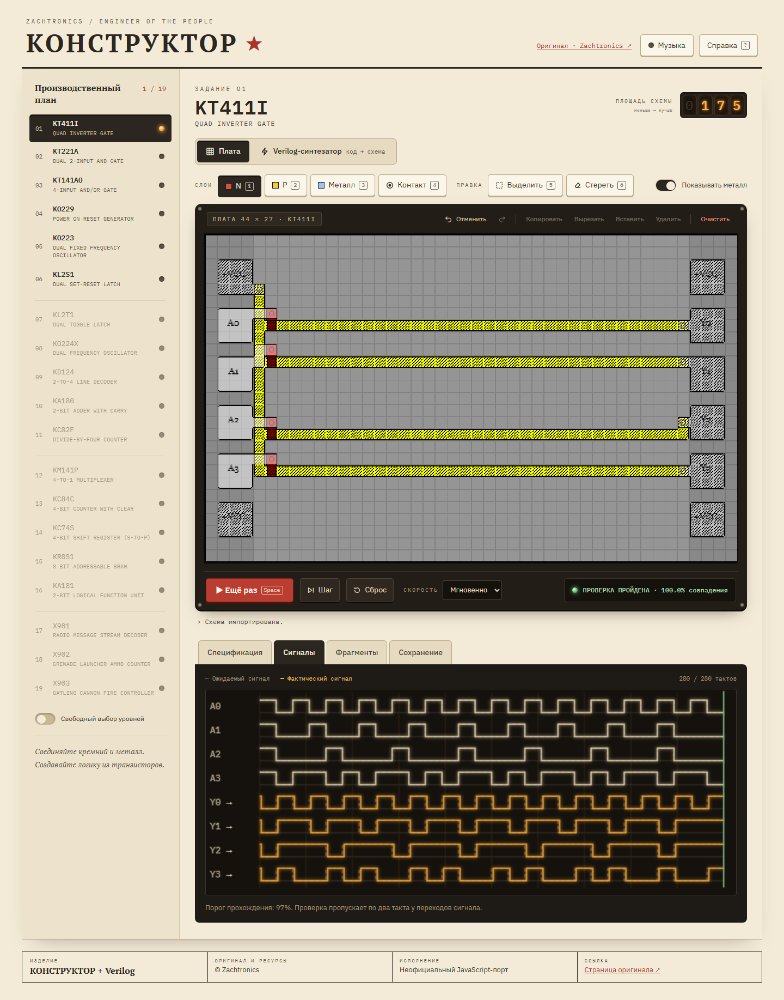
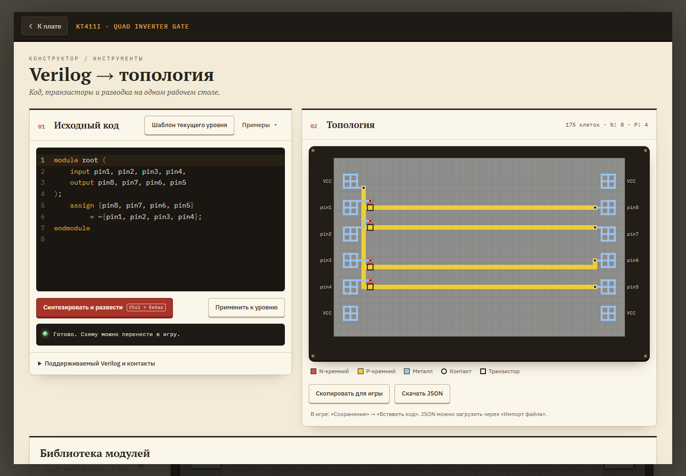
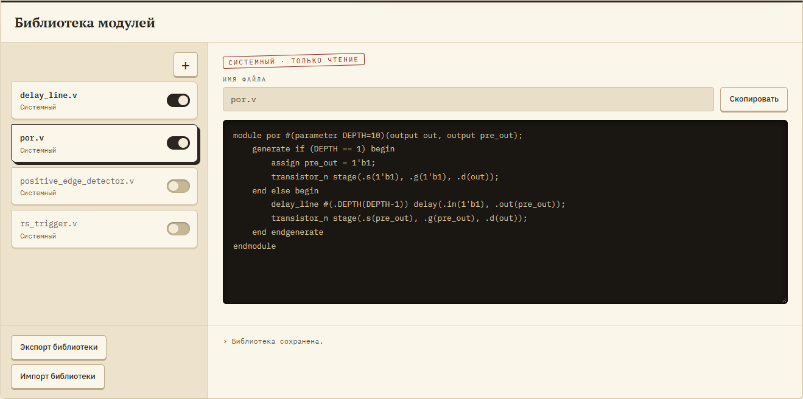

# КОНСТРУКТОР + Verilog

**[Играть в браузере →](https://parus95.github.io/kohctpyktop-verilog/)**

Неофициальный браузерный порт KOHCTPYKTOP: Engineer of the People с редактором схем, симулятором и TypeScript-синтезатором Verilog.

[Оригинальная игра Zachtronics](https://www.zachtronics.com/kohctpyktop-engineer-of-the-people/). Оригинальные материалы и дизайн принадлежат Zachtronics; этот проект не аффилирован с автором игры.

## Как это выглядит







## Запуск

Node.js 24 или новее:

```sh
npm ci
npm run dev
```

Игра и синтезатор доступны на http://127.0.0.1:5174/. Кнопка **⚡ Verilog-синтезатор** открывает редактор внутри игры. При первом открытии показывается только шаблон контактов, без готового решения. Примеры спрятаны в выпадающее меню; синтез запускается явно. Сохранённый код восстанавливается при следующем открытии. **Шаблон текущего уровня** создаёт `root` с направлениями DIP-контактов и комментариями с названиями сигналов. **Применить к уровню** переносит результат в текущую схему; действие можно отменить.

`npm run build` создаёт самостоятельный статический сайт в `dist/`. Относительные пути позволяют размещать его и в корне, и под префиксом GitHub Pages.

## Библиотека

Встроенные `transistor_n` и `transistor_p` всегда доступны. Готовые `positive_edge_detector`, `rs_trigger`, `delay_line` и `por` находятся в `synth/library/` и отображаются как системные модули. Они выключены по умолчанию; для `por` включите также `delay_line`. Для примеров из dropdown нужные системные модули также включаются вручную.

Выберите карточку для просмотра; системный код открыт только для чтения. «Скопировать» рядом с именем создаёт редактируемую пользовательскую копию, изначально выключенную. Перед включением копии отключите оригинал или переименуйте модуль в коде. Кнопка «+» создаёт свой модуль. Пользовательские файлы сохраняются в localStorage, включаются флажком; доступны удаление и экспорт/импорт JSON.

Порты транзистора — `s`, `g`, `d`; `1'b1` означает VCC. Для цепочек поддерживаются целочисленные параметры 1–64, арифметика параметров `+`/`-` и `generate if (PARAM == число) begin ... end else begin ... end endgenerate`. Это ограниченный набор Verilog, не полная реализация стандарта.

POR, delay_line и RS разворачиваются из Verilog в обычные транзисторы. В `synth/src/library/` остался только примитив транзистора; дублирующие TypeScript-генераторы и фиксированные раскладки удалены. Общий роутер выбирает расположение по соединениям.

## Синтез и задержки

- `a & ~b` оптимизируется в один P-транзистор: источник `a`, затвор `b`. Сигнал `a` проходит в текущем такте; затвор использует предыдущий такт.
- `a | b` может объединить две внутренние выходные сети, если у них нет других потребителей или внешних контактов. При наличии обратной связи или другого использования оптимизация запрещена.
- `^` использует четырёхтранзисторную схему из `solutions.v`; константы распространяются до создания транзисторов.
- `|` работает побитово, `||` сворачивает операнды в один логический бит. Для скаляров результаты совпадают.
- Разводчик пробует перестановки последовательных транзисторов только без отводов и обратной связи через промежуточные узлы. Линии задержки сохраняют порядок.
- Задержки и RS могут распознаваться по соединениям для отображения нетлиста, но не получают заранее заданных координат при разводке.

## Проверки

```sh
npm test
npm run test:solutions
npm run test:browser
npm run build
npm run test:production
```

Браузерный тест локально использует установленный Microsoft Edge. В CI устанавливается Chromium. `test:browser` проверяет запущенный dev-сервер; `test:production` сам поднимает временный сервер сборки под `/kohctpyktop/` и закрывает его после проверки.

`solutions.v` скопирован без изменений из пользовательского исходника. Разделители и номера уровней разбирает `scripts/solution-cases.mjs`. Последний вариант каждого уровня обязателен для прохождения, более ранние варианты тоже запускаются и отображаются в отчёте. Представлены 11 уровней: 1–7, 9–12; отсутствующие 8 и 13–19 явно отмечаются. Порог — оригинальные 97%, а не произвольная таблица истинности. Из 14 вариантов 13 проходят; ранний неполный вариант уровня 5 даёт 76%. Итоговый отчёт: `test-results/solutions.json`.

## Состав репозитория

- `game/`: проверенный игровой движок и интерфейс JS; его полная миграция на TypeScript пока не выполнена и не нужна для сборки.
- `src/`: типизированная интеграция, генерация шаблонов уровня и общая тема оформления `theme.css` (цвета, шрифты, лампы-индикаторы) для игры и синтезатора.
- `synth/src/`: TypeScript AST, разворачивание модулей, синтез, оптимизация и разводка.
- `synth/library/`: системные модули на Verilog; `synth/examples/`: примеры использования.
- `public/assets/`: необходимые оригинальные ресурсы игры.
- `tests/`, `synth/tests/`, `scripts/`: проверки движка, компилятора, решений и интерфейса.

Не входят в Git: node_modules, dist, кэши npm, логи, результаты/скриншоты тестов, ZIP, SWF, декомпиляторы и их выгрузки, `.env` и пользовательские сохранения браузера. Старые проекты рядом с этой папкой не удалены.

## GitHub Pages

Workflow `.github/workflows/pages.yml` выполняет тесты, сборку, браузерную проверку и публикует `dist/` при push в `main`. Перед первым запуском включите в GitHub **Settings → Pages → Source: GitHub Actions**. Для PR выполняются проверки без публикации. [Документация GitHub](https://docs.github.com/en/pages/getting-started-with-github-pages/using-custom-workflows-with-github-pages).

Сайт: https://parus95.github.io/kohctpyktop-verilog/. Репозиторий: [parus95/kohctpyktop-verilog](https://github.com/parus95/kohctpyktop-verilog).
